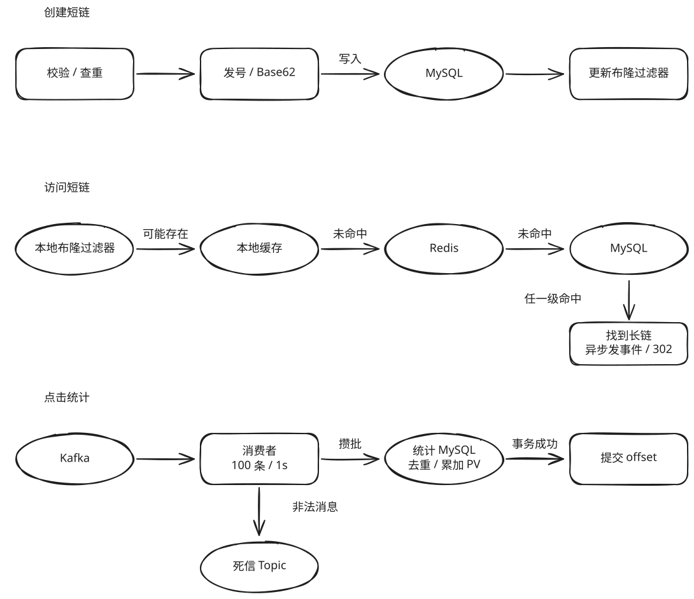

# 短链接项目 

## 1. 建库建表
在真实项目中要将两个表放在不同数据库中
1. 发号器
```sql
CREATE TABLE `sequence` (
  `id` bigint(20) unsigned NOT NULL AUTO_INCREMENT,
  `stub` varchar(1) NOT NULL,
  `timestamp` timestamp NOT NULL DEFAULT CURRENT_TIMESTAMP ON UPDATE CURRENT_TIMESTAMP,
  PRIMARY KEY (`id`),
  UNIQUE KEY `idx_uniq_stub` (`stub`)
) ENGINE=MyISAM DEFAULT CHARSET=utf8 COMMENT = '序号表';
```
2. 长短链映射表
```sql
CREATE TABLE `short_url_map` (
    `id` BIGINT UNSIGNED NOT NULL AUTO_INCREMENT COMMENT '主键',
    `create_at` DATETIME NOT NULL DEFAULT CURRENT_TIMESTAMP COMMENT '创建时间',
    `create_by` VARCHAR(64) NOT NULL DEFAULT '' COMMENT '创建者',
    `is_del` tinyint UNSIGNED NOT NULL DEFAULT '0' COMMENT '是否删除：0正常1删除',
    
    `lurl` varchar(2048) DEFAULT NULL COMMENT '长链接',
    `md5` char(32) DEFAULT NULL COMMENT '长链接MD5', 
    `surl` varchar(11) DEFAULT NULL COMMENT '短链接',
    PRIMARY KEY (`id`),
    INDEX(`is_del`),
    UNIQUE(`md5`),
    UNIQUE(`surl`)
)ENGINE=INNODB DEFAULT CHARSET=utf8mb4 COMMENT = '长短链映射表';
```

## 2. 编写 api 文件
编写后生成 gozero 代码:
```bash
goctl api go -api shorturl.api -dir .
```

## 3. 根据数据库的表生成对应的代码
```bash
goctl model mysql datasource -url="root:root123456@tcp(127.7.7.1:13306)/shorturl" -table="sequence" -dir="./model"
```
```bash
goctl model mysql datasource -url="root:root123456@tcp(127.7.7.1:13306)/shorturl" -table="short_url_map" -dir="./model"
```

##  4. 配置 shorturl-api.yaml 和 config.go 中的数据库配置
在 shorturl-api.yaml 中加入这两条:
```yaml
SequenceDB:
  DSN: root:root123456@tcp(localhost:3306)/shorturl?charset=utf8mb4&parseTime=True&loc=Asia%2FShanghai
ShortURLDB:
  DSN: root:root123456@tcp(localhost:3306)/shorturl?charset=utf8mb4&parseTime=True&loc=Asia%2FShanghai
```
config.go中加入两个DB
```go
type Config struct {
	rest.RestConf
	SequenceDB struct {
		DSN string
	}
	ShortUrlDB struct {
		DSN string
	}
}
```

## 5. 将两个 db model 引入到 svc 中
在 internal/svc/servicecontext.go 中加入 ShortUrlModel 和 SequenceModel
```go
type ServiceContext struct {
	Config        config.Config
	ShortUrlModel model.ShortUrlMapModel
	SequenceModel model.SequenceModel
}

func NewServiceContext(c config.Config) *ServiceContext {
	sUrlConn := sqlx.NewMysql(c.ShortUrlDB.DSN)
	seqConn := sqlx.NewMysql(c.SequenceDB.DSN)

	return &ServiceContext{
		Config:        c,
		ShortUrlModel: model.NewShortUrlMapModel(sUrlConn),
		SequenceModel: model.NewSequenceModel(seqConn),
	}
}
```
## 6. 编写业务代码

## 7. 编写单元测试为某些函数
可以用 vscode 自动生成测试框架
目前为 pkg 中的工具函数、消费者和点击记录 model 编写了单元测试

```bash
go test ./...
```

## 8. 编写点击事件消费者
1. 点击记录表

```sql
CREATE TABLE `click` (
    `id` BIGINT UNSIGNED NOT NULL AUTO_INCREMENT COMMENT '主键',
    `surl` VARCHAR(11) NOT NULL COMMENT '短链标识',
    `ts` BIGINT NOT NULL COMMENT '点击时间，Unix 毫秒时间戳',
    `created_at` DATETIME NOT NULL DEFAULT CURRENT_TIMESTAMP COMMENT '入库时间',
    `event_id` CHAR(36) CHARACTER SET ascii COLLATE ascii_bin NOT NULL COMMENT '点击事件唯一标识',
    PRIMARY KEY (`id`),
    UNIQUE KEY `idx_unique_event` (`event_id`)
) ENGINE=InnoDB DEFAULT CHARSET=utf8mb4 COMMENT='短链点击记录';
```

将建表语句保存到 click.sql 并执行，再生成 model：

```bash
goctl model mysql ddl -src click.sql -dir ./model
```

短链存入 surl 字段，event_id 使用唯一索引去重
批量插入方法写在 clickmodel.go 中，不改生成的代码

2. 在 shorturl-api.yaml 中加入消费者配置，对应字段放在 config.go 中

```yaml
ClickDB:
  DSN: root:root123456@tcp(localhost:13306)/shorturl?charset=utf8mb4&parseTime=True&loc=Asia%2FShanghai
Kafka:
  Brokers:
    - localhost:9092
  Topic: shorturl_clicks
  GroupID: shorturl-consumer
  DeadLetterTopic: shorturl_clicks_dlq
  BatchSize: 100
  FlushInterval: 1s
```

3. 创建 Kafka topic

主 topic 为 shorturl_clicks，死信 topic 为 shorturl_clicks_dlq
本地单 broker 使用 1 个副本，死信选择 Delete，保留 4 周

4. 编写消费者逻辑

攒满 100 条或者等待 1 秒后批量写入 MySQL，成功后再提交 offset
临时写库错误最多重试 3 次，间隔 1 秒，失败退出后重新启动可以消费未提交的消息，前提是消息还没过期
重复消息通过 event_id 去重，提交失败只重试提交
JSON 解析失败先处理前面正常消息，再写死信，成功后提交 offset，死信重放工具还没写
退出时最多用 4 秒写完剩余批次并提交，再关闭连接，进程最多等待 30 秒

跳转接口尝试将点击事件放入容量为 4096 的内存队列。队列满时记录 event_id，跳转照常返回，该点击可能漏记
后台每批最多取 100 条，使用 RequireAll 等待 Kafka 确认。投递失败时使用原 event_id 补写 click 表，避免重复计数
补写最多等待 4 秒，临时数据库错误最多重试 3 次。Kafka 和 MySQL 同时不可用时记录未能保存的事件
API 退出时最多等待 10 秒处理已入队的事件，进程强退或队列未排空时可能丢失内存中的点击事件

5. 启动消费者

```bash
go run ./cmd/consumer -f etc/shorturl-api.yaml
```

## 9. 压测发现的问题和配置调整
1. 消费者逐条写库，请求次数太多

3000 条消息逐条写需要执行 3000 次 SQL，改成每批 100 条后只需要 30 次。
同时减少 offset 提交次数，所以采用批量写入，低流量时通过 1 秒刷新避免一直等满一批。

2. 数据量增长后，MySQL 缓冲池太小

持续压测时，表和索引约 534 MB，MySQL 缓冲池只有 128 MB，物理读和等待空闲缓冲页的次数增加，消费者开始积压。
保持每批 100 条、每秒发送 5000 条，调整缓冲池前后对比：

| MySQL 缓冲池 | 实际测试时间 | 结果 |
| --- | --- | --- |
| 128 MB | 约 20 秒 | 积压持续增长到 25700 条，触发停止发送 |
| 1 GB | 60 秒 | 前期积压能够消化，30 万条全部入库，停发后约 0.31 秒排空 |

说明数据库缓存压力是这次持续消费的重要瓶颈，不能只看短时吞吐，也不能只靠增大批量解决。
测试使用本地 Docker、单 broker、单分区、单消费者，只测 Kafka 到 MySQL，不包含 HTTP 接口。
以上是当前环境下的验证结果，不代表生产环境容量上限。

3. 最终采用的配置

消费者保留每批 100 条、1 秒刷新：

```yaml
Kafka:
  BatchSize: 100
  FlushInterval: 1s
```

MySQL 缓冲池采用 1 GB，对应 MySQL 配置：

```ini
[mysqld]
innodb_buffer_pool_size=1G
```

每批 100 条已经通过每秒 5000 条、持续 60 秒的验证。
500 条虽然也做过压测，但使用了不同发送速率，不能据此认定它是更优默认配置，所以暂时保持 100 条。

目前消费者配置已在项目中。MySQL 的 1 GB 只通过 SET GLOBAL 临时生效，上面的 MySQL 配置尚未写入容器实际加载的配置文件，重启后需要重新确认。
测试记录和 Kafka 已消费历史消息已清理。复测要准备相近的数据规模，不能用清理后的空表结果代替大表测试。
